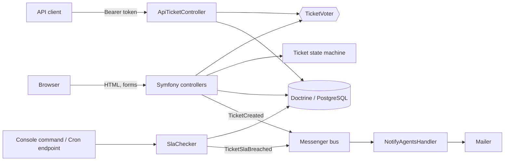

# Architecture

## Overview

Two firewalls: `api` (stateless, bearer token) and `main` (session login). Sessions are stored in PostgreSQL,
so any number of stateless instances can serve a user.

## Access model

| Role | Can see | Can do |
|---|---|---|
| Customer | own tickets | open tickets, reply while the ticket is active, close or reopen their own |
| Agent (`ROLE_AGENT`) | tickets assigned to them or unassigned | everything on those tickets, internal notes, assign, change status |
| Admin (`ROLE_ADMIN`) | everything | everything |

The rules live in one place, `App\Security\TicketVoter`, and the list query (`TicketRepository::findVisibleTo`)
mirrors them so a listing never shows something a detail page would refuse. Both are covered by tests.

## Decisions

**State machine for status.** A ticket's status changes only through named transitions. This blocks invalid jumps
(open → closed) in one place instead of scattered `if`s, and the UI only offers transitions that are enabled.

**SLA as data, not a cron-only concern.** `responseDueAt` is stored on the ticket, so overdue tickets are one indexed
query. The breach flag is set *before* dispatching the notification, so a failing mail can never cause a notification loop.

**API tokens are hashed.** Only a SHA-256 of the token is stored (tokens are 192 random bits, so a fast hash is
appropriate); a database leak does not expose usable credentials.

**Explicit API output (`TicketView`).** Entities are never serialised directly, so a new column can't leak by accident.

**Stateless-friendly.** DB sessions, logs to stderr, config from environment, cache dir redirected to `/tmp` on
Vercel. The same code runs on a conventional container and on serverless.

**Demo-only toggles.** `REQUIRE_EMAIL_VERIFICATION=0` exists for demo hosts with no mail provider. It defaults to on.

## Known limits

- Notification emails need a worker (`messenger:consume`) on conventional hosting; on Vercel use `MESSENGER_TRANSPORT_DSN=sync://`.
- No file attachments, and no full-text search (simple `LIKE` filtering).
- Fixtures share one demo password and must never be loaded into a real production database.
